# Architecture

This document explains how WatchParty Sync is built and how WebSockets fit into every flow. Diagrams use [Mermaid](https://mermaid.js.org/) and render directly on GitHub.

## Contents

1. [System overview](#1-system-overview)
2. [Server design](#2-server-design)
3. [Data model](#3-data-model)
4. [Playback synchronization](#4-playback-synchronization)
5. [Role-based access control](#5-role-based-access-control)
6. [Request and approve flow](#6-request-and-approve-flow)
7. [Joining, late joiners and leaving](#7-joining-late-joiners-and-leaving)
8. [Client design](#8-client-design)
9. [Reconnection](#9-reconnection)
10. [Deployment topology](#10-deployment-topology)
11. [Scaling design](#11-scaling-design)
12. [Security considerations](#12-security-considerations)

---

## 1. System overview

The browser talks to the server over one long-lived WebSocket connection (Socket.IO). The server owns all room state. The YouTube player runs only in the browser.

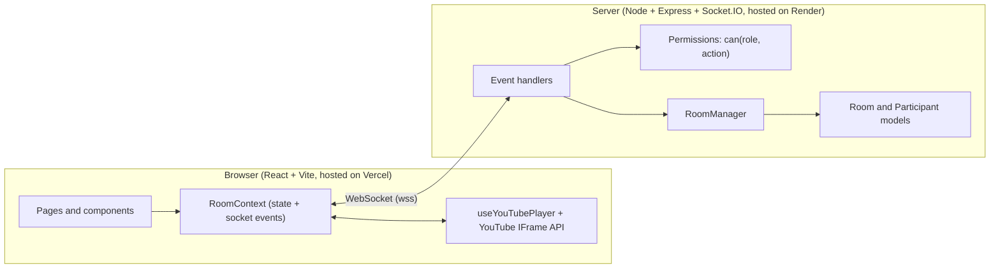

**Why WebSockets:** playback control needs low-latency, two-way, server-initiated messages (the server pushes `sync_state` to everyone without being asked). HTTP polling would add delay and load. Socket.IO adds rooms, acknowledgements and automatic reconnection on top of WebSockets.

**One rule drives the design:** the server is the single source of truth. Clients send *intents* (for example `pause`), the server validates and updates state, and then tells everyone else what the new state is.

---

## 2. Server design

The server is object-oriented. Each class has one job.

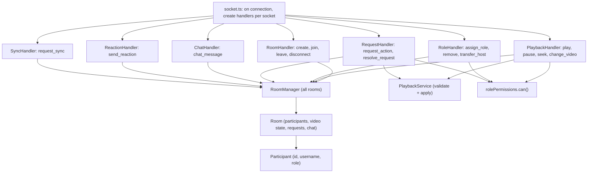

| Class or module | Responsibility |
|---|---|
| `RoomManager` | Owns the map of rooms, generates unique room codes, maps socket id to room, creates and deletes rooms |
| `Room` | Participants, `VideoState`, pending requests, chat history, host invariant (`transferHost`, `promoteNextHost`) |
| `Participant` | One user: id, username, role |
| `*Handler` classes | Listen to socket events, run checks, call the model, broadcast results |
| `rolePermissions` | A single table of role to allowed actions, and `can(role, action)` |
| `PlaybackService` | Shared payload validation and "apply this action to the room" logic, used by both direct control and approved requests |

### Every state-changing event goes through the same three gates

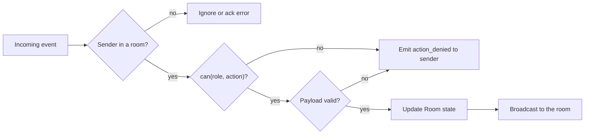

---

## 3. Data model

All state lives in memory inside the server process.

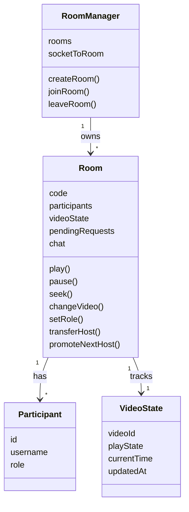

`Role` is `host`, `moderator` or `participant`. A participant's `id` is the Socket.IO socket id.

### Live playback position

The server does not run a timer. It stores the position at the last change plus the time of that change, and computes the live position on demand:

```
if playState == "playing":
    livePosition = currentTime + (now - updatedAt) / 1000
else:
    livePosition = currentTime
```

This is what lets a late joiner start at the right place without any background work.

---

## 4. Playback synchronization

### Host or Moderator controls playback

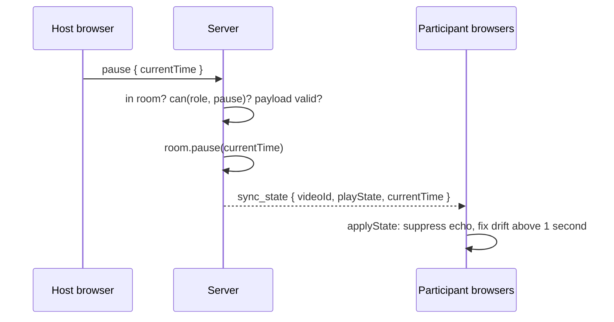

Notes:

- The sender is **excluded** from the broadcast (`socket.to(room)`). The sender's own player already shows the change, so this avoids an echo loop.
- `play` and `pause` include the sender's `currentTime` so all clients align to the exact moment of the action.

### Client details that make sync reliable

| Problem | Solution |
|---|---|
| Calling `playVideo()` for a remote change fires the player's own state event, which would send a new event | A suppress flag is set for about 1.2 seconds whenever remote state is applied |
| The YouTube IFrame API has no seek event | Poll `currentTime` every 500 ms; a jump larger than 1.5 seconds beyond what playback explains is treated as a seek |
| Small timing differences between clients | Only seek when drift is larger than 1 second |
| A viewer's tab was in the background or the network lagged | Resync button, and automatic correction every 20 seconds for viewers who cannot control playback |
| A Host loads a new video | The change goes to others via the server, and the Host's own player is loaded locally at the same time |

---

## 5. Role-based access control

Permissions are defined once and enforced on the server.

| Action | Host | Moderator | Participant |
|---|:-:|:-:|:-:|
| play, pause, seek, change_video | ✅ | ✅ | ❌ |
| resolve_request | ✅ | ✅ | ❌ |
| assign_role, remove_participant, transfer_host | ✅ | ❌ | ❌ |

### Role changes are broadcast to everyone

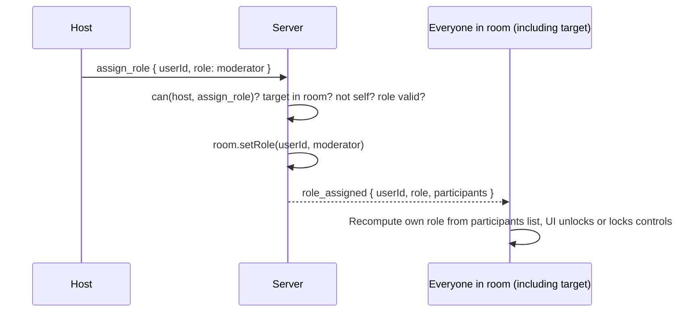

Each client derives its own role from the `participants` list in every event, so the UI cannot drift from the server's truth.

### Host invariants

- A room always has exactly one Host.
- `transfer_host` makes the previous Host a Moderator.
- If the Host leaves or disconnects while others remain, `promoteNextHost()` picks the first Moderator, otherwise the longest-present Participant, and `host_transferred` is broadcast.
- When the last person leaves, the room is deleted.

---

## 6. Request and approve flow

A Participant cannot control playback, but can ask for it. Only an approval makes the change apply.

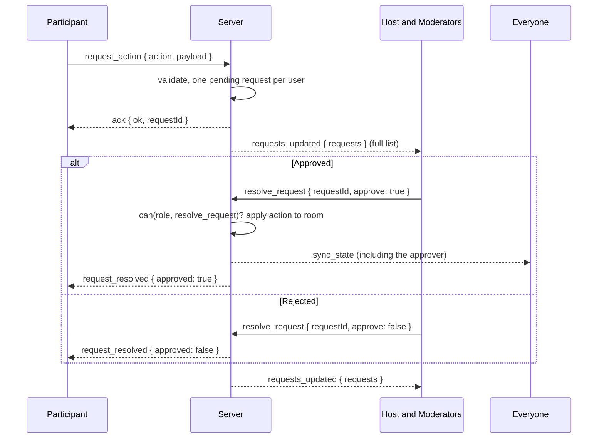

Design points:

- **Full-list snapshots** (`requests_updated`) are sent instead of incremental events, so a newly promoted Moderator immediately sees pending requests and state can never get out of sync.
- On approval, `sync_state` goes to **everyone including the approver**, because the approver's own player has not changed yet.
- A user's pending request is removed automatically when they leave.

---

## 7. Joining, late joiners and leaving

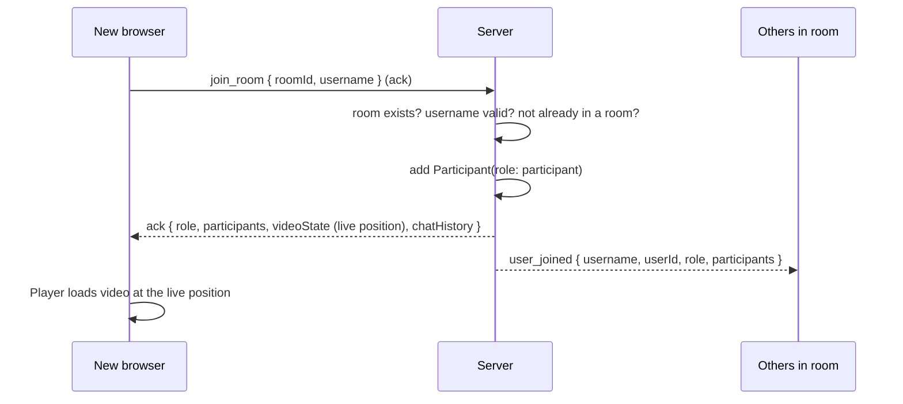

Leaving (button, closing the tab or a dropped connection) runs the same path: remove the participant, clean up their pending requests, promote a new Host if needed, delete the room if empty, and broadcast `user_left`.

Room codes are 6 characters from an alphabet without look-alike characters (`0/O`, `1/I`), checked for uniqueness. Opening `/room/CODE` directly shows a join form, which is how invite links work.

---

## 8. Client design

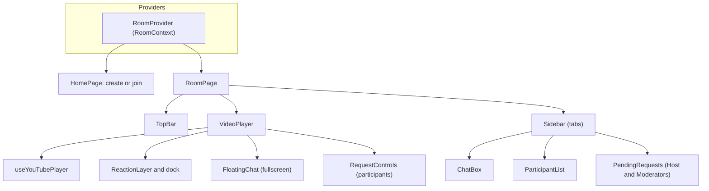

- **`RoomContext`** is the only place that listens to socket events. It holds the room state (participants, own role, video state, chat, pending requests) and exposes actions such as `sendPlay`, `assignRole`, `sendChat`. Components never touch the socket directly (except through the context).
- **`useYouTubePlayer`** wraps the IFrame API: it loads the script once, creates the player, applies server state, and reports user-initiated play, pause and seek.
- **Custom fullscreen:** the YouTube player's own fullscreen button only fullscreens the iframe. It is disabled (`fs: 0`), and a custom button fullscreens the wrapper element instead, so chat, reactions and notices render on top of the video.
- **Participants cannot control the player:** a transparent overlay blocks clicks for non-controllers. Because the overlay is separate from the player, a role change simply removes it, with no need to recreate the player.

---

## 9. Reconnection

A new connection gets a new socket id, and the server has already removed the old participant on disconnect. The client therefore rejoins explicitly.

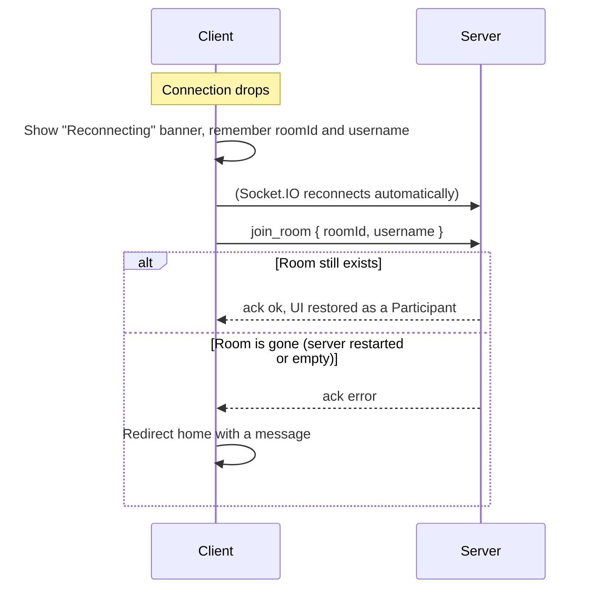

**Trade-off:** the user returns as a Participant, not their previous role, and for a short time the old entry may linger until the server detects the dropped connection. See the limitations in the README for the persistent-identity improvement.

---

## 10. Deployment topology

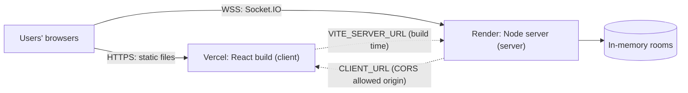

| Concern | Choice |
|---|---|
| Static frontend | Vercel, with a rewrite of all paths to `index.html` so `/room/CODE` works on refresh |
| Realtime backend | Render web service, which supports long-lived WebSocket connections |
| Configuration | Environment variables only; no secrets in the client |
| Health check | `GET /health` returns `{ "status": "ok" }` |
| Build | `npm install --include=dev && npm run build`, then `npm start` (`node dist/server.js`) |

---

## 11. Scaling design

The current build is a single process with in-memory state, which is right for an assignment and for a few hundred concurrent users. This is how it would scale to 1,000+ users, 100+ rooms and 50+ users per room.

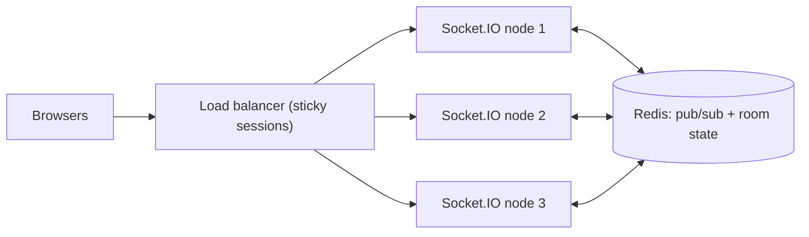

| Step | What changes |
|---|---|
| Cross-node broadcast | Add the Socket.IO **Redis adapter** so `io.to(room).emit` reaches sockets on every node |
| Sticky sessions | Route a client to the same node during the Socket.IO handshake (needed for long-polling fallback) |
| Shared state | Move room state (participants, video state, requests, recent chat) from process memory into Redis |
| Room ownership | Keep room logic in one place, for example per-room keys with atomic updates, or route each room to one owner node |
| Persistence | Store room metadata in a database so rooms survive restarts |
| Identity | Persistent user ids and a reconnect grace period, so a refresh keeps the user's role |

Because all room logic is already behind `RoomManager` and `Room`, the migration is mostly swapping the storage behind those classes. Handlers would not need to change.

**Per-room load:** a 50-person room is cheap. Playback events are rare and tiny, chat and reactions are rate limited (chat: one message per 500 ms, reactions: 150 ms), and `requests_updated` goes only to Host and Moderators.

---

## 12. Security considerations

| Area | Measure |
|---|---|
| Authorization | Every state-changing event checks room membership and `can(role, action)` on the server |
| Input validation | Times must be finite numbers at or above zero; video ids match a strict 11-character pattern; usernames are trimmed and length limited; chat text is 1 to 300 characters |
| Allowlists | Reactions accept only a fixed set of emojis; roles accept only `moderator` or `participant` through `assign_role` |
| Abuse limits | Chat and reaction rate limits; one pending request per user |
| XSS | Chat and usernames are rendered as plain text by React; `dangerouslySetInnerHTML` is never used |
| CORS | Only the configured `CLIENT_URL` origin is allowed |
| Room access | The room code acts as the access token; codes are random and 6 characters from a 32-character alphabet |
| Secrets | None in the client bundle; configuration is injected through environment variables |

**Not covered (by design for this scope):** user authentication, per-room blocklists and persistent sessions. They are listed as future work in the README.
